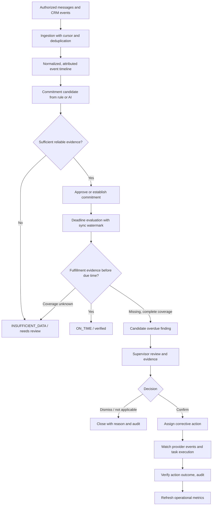

# SupportPulse AI — Scenario Specification & Dashboard Information Architecture v0.2

**Maya AI Systems · 22 October 2026 · DESIGN DRAFT · not deployed · no client data**
**Parent:** `SupportPulse_AI_Product_Discovery_Blueprint_v0.1.md`
**Scope:** one vertical slice, end-to-end, with testable acceptance criteria. This is a design artifact, not a market-fit claim or evidence of implementation.

## 0. Decision summary

**Problem to prove:** A company cannot reliably tell whether an agreed customer follow-up actually happened across conversation channels and CRM, or what remedial action produced.

**Buyer hypothesis:** owner/head of sales of a multi-manager company selling through consultations/quotes, with conversation and CRM data. Validate in interviews. **Not locked to Bitrix24**, any channel, or furniture until pilot access is verified.

**User job:** “Show me verifiable customer commitments that need attention today, who can act, why you believe they are at risk, and what happened after the intervention.”

**Initial product loop:** ingest → reconcile → extract commitment → check evidence → human review → task → verify action/outcome → measure. This is **not** a new CRM, autonomous staff disciplinarian, or factually proven financial attribution engine.

## 1. First user story (US-001)

> As a head of sales, I want to detect a customer quote promised by a certain deadline that has not been visibly sent, confirm the evidence, route a corrective task to the responsible person, and later verify whether the quote was delivered, so that follow-ups do not quietly stall.

### Example fixture (SYNTHETIC — NOT A REAL CUSTOMER)

- Company: Demo Studio; all names synthetic.
- Company timezone: Europe/Moscow (configurable per tenant); events are stored in UTC and displayed locally.
- 10:05 — contact `demo-lead-001` asks for a kitchen quote in an authorized channel.
- 10:18 — manager `demo-manager-001`: “Отправлю расчёт сегодня до 16:00”.
- 10:19 — extraction service produces candidate commitment: `send_quote`, due `2026-10-22T16:00:00+03:00`, actor `demo-manager-001`, source_message_id `msg-002`, **proposed, not verified**.
- 10:21 — human-approved or policy-permitted rule makes the commitment active; first release requires **human confirmation of AI-derived deadlines** unless the deadline is an explicit structured CRM field.
- 16:30 — the ingestion cursor for the relevant outbound channel has advanced beyond the deadline + 30-minute ingestion allowance; there is no supported `quote_sent` evidence or signed override. Deterministic rule creates a **candidate overdue finding**, not a factual claim that the client never received a quote.
- 16:34 — supervisor checks linked messages and CRM history, confirms the case and assigns a correction by 17:00.
- 17:12 — authenticated provider event says quote was sent with a linked document/reference; corrective task completes.
- CRM deal outcome = **UNKNOWN**; revenue recovered = **UNKNOWN**, even though the action has been completed.

### Essential negative cases

A. Missing outbound sync/insufficient source coverage → `INSUFFICIENT_DATA`; do **not** generate “manager failed”.

B. Quote sent in another channel with *verified* same-contact identity before deadline → no overdue finding.

C. Identical external event ingested twice → 1 message, 1 commitment, 1 finding, at most 1 active corrective task.

D. Deadline vague (“завтра”, “скоро”, “на неделе”) or message ambiguous → `NEEDS_HUMAN_REVIEW`; don't invent exact time.

E. Company business calendar or explicit customer promise: explicit absolute promised deadline wins over general SLA unless policy states otherwise; changes to the policy are versioned.

F. Customer refuses quote or manager logged a documented agreed cancellation → finding can be closed `NOT_APPLICABLE` with evidence and reviewer.

G. Later arrival of historical events reverses an earlier conclusion → finding updated/reopened, original audit remains immutable.

H. Quote sent but bounced/undelivered → separate status `SENT_UNCONFIRMED_DELIVERY`; never claim received.

## 2. Roles, decisions and permissions

| Role | Can view | Can change | Cannot |
|---|---|---|---|
| Owner / head of sales | Organizational KPIs, evidence within own tenant, audit | Verify/assign/override with reason; review incidents | Read another tenant, rewrite imported evidence |
| Team lead | Scoped team metrics and case cards | Approve/assign cases within scope | Change org-wide retention/settings without role |
| Manager | Own cases and assigned actions | Reply with explanation; mark action complete with evidence; contest finding | Approve own disputed evaluation; see unrelated personal conversations |
| Integration admin | Sync health, credentials status, source mapping | Configure approved connectors, working hours and permissions | Silently erase audit or expose credentials to dashboard |
| Auditor | Permitted case history and policy versions | None by default | Mutate findings or original records |

No automatic employee disciplinary decision or external message sent to customers as a result of an unreviewed LLM assessment.

## 3. The end-to-end process, including explicit sources



**Watermark meaning:** the provider offset/date of the most recently fully ingested portion of each required source. `no evidence found` alone is NOT equivalent to `the action did not happen`.

**Provenance:** link findings to original provider identifier, timestamp, role, quote/excerpt (where permitted), rule version, AI model/prompt version if applied, sync run and reviewer action.

## 4. Main screen — IA-01: Executive / Operations Overview

**Purpose:** at a glance answer: What needs my attention *today*? Is the data sufficiently complete? Are corrective actions working?

Layout on desktop (structure, not approved visual style):

```text
┌──────────────────────────────────────────────────────────────────────────────┐
│ SupportPulse AI     [Company] [Period] [Team] [Channel] [Data Health]       │
├──────────────────┬───────────────────────────────────────────────────────────┤
│ OVERVIEW         │  ACTION REQUIRED                                          │
│ Cases & Evidence │  [Needs review] [Confirmed overdue] [Tasks overdue]       │
│ Funnel & Revenue │  [Sync health / unknown coverage clearly shown]           │
│ Team & Quality   ├───────────────────────────────────────────────────────────┤
│ Economics        │  OPERATIONAL METRICS (with numerator/denominator)         │
│ Integrations     │  Due commitments / On-time % / Review precision           │
│ Rules & Audit    │  Median/P90 response / Avg resolution duration            │
│                  ├───────────────────────────────────────────────────────────┤
│                  │  TRENDS                                                     │
│                  │  Compare equivalent periods; markers for source gaps       │
│                  ├───────────────────────────────────────────────────────────┤
│                  │  URGENT CASE QUEUE                                        │
│                  │  Customer alias · promise · due · source · evidence · CTA  │
└──────────────────┴───────────────────────────────────────────────────────────┘
```

**Strict layout rule:** operational queue above executive vanity charts. Empty KPI = “Нет достаточных данных” with precise coverage reason; never fill with sample production numbers.

### Top KPIs — working definitions

1. **Review backlog:** count distinct findings in `NEEDS_REVIEW`, including rules that lacked enough context; do not conflate with confirmed violations.
2. **Confirmed overdue:** count reviewed/confirmed overdue commitments in selected mature due-date cohort; breakdown by team/channel and available evidence.
3. **Follow-up on-time rate:** `verified_on_time / (verified_on_time + confirmed_overdue)` on commitments with reliable due and sufficient source coverage. Report `N excluded unknown` and applicable work calendar. Prevent division by zero.
4. **Median/P90 first meaningful reply:** between inbound and human response for conversations with reliably paired timestamps; bots and after-hours policy are identified.
5. **Action completion:** `corrective_actions_verified / corrective_actions_created` for selected mature cohort; distinguish completed late/on time and unresolved.
6. **Data coverage:** fraction of expected relevant sources and eligible events with verified sync + identities + timestamps. If denominator isn't reliably known, show connector health and coverage category rather than fabricated %.
7. **False alert / reviewer agreement:** verified sample-based precision with sample size. No fake “AI accuracy” without a labeled sample.
8. **Economics:** hidden from main KPI row until reliable deal outcome/margin; when displayed, risk scenario and verified money are visually distinct and source linked.

Charts: new vs confirmed findings by week; percent follow-up on time by channel; age buckets of unresolved cases; resolution time distribution; team comparison **normalized** by message volume/working hours and incomplete coverage.

## 5. Detail flow — IA-02 Cases list, IA-03 Case detail

**Cases list fields:** case ID, customer alias, channel, owner, promised action, due-local, sync/data confidence, severity (rules-based, reviewable), current state, time open, last action. Filters: state, team, owner, source, period, has evidence, sync health. Sorting by urgency & verified impact, not model tone.

**Case detail, 3 columns desktop / stack mobile:**

- Left: chronological timeline (customer + manager messages, CRM stage changes, tasks, document status) with provider identifiers and sync status.
- Center: extracted promise and raw evidence, due date and timezone, source quote, conflict/identity flags, `policy_version`, distinction `Observed / Inferred / Unknown`.
- Right: human decisions: Confirm, Dismiss (requires reason), Need data, Assign action (owner, due), Escalate according to company policy, mark corrected (requires source evidence), contest/history. No HR disciplinary button.

**Single user success path:** open finding → inspect proof → confirm → assign manager → observe authentic quote-sent event → verified closure → see audit and refreshed rate. All changes server-side, permission checked, idempotent, and audited.

## 6. Supplementary screens and release boundary

| Screen | Pilot v0.1 | Next release / evidence gate |
|---|---|---|
| Executive Overview | Queue, coverage, baseline KPIs, weekly trends | Cross-channel causal cohort analysis; custom layouts |
| Cases & Evidence | Full interactive listing and case detail | Assisted dedup, advanced text search |
| Team & Quality | Queue/load breakdown for role scope, contest mechanism | Coaching journeys only after fair QA policy and benchmark |
| Funnel & Revenue | Optional imported CRM events, descriptive funnel | Attribution/payment joins only with reliable identity, cohort, cost sources |
| Economics | Distinct basic scenario calculator with manual inputs and disclaimers | Verified ROI / profit impact only with validated measurement |
| Integrations | CSV/JSON synthetic import, source sync-health page | ONE approved real read-only CRM connector; additional channels later |
| Rules & Audit | Deadlines/timezones, rule versions, actions history | Rule builder with simulation and audit signoff |

Main navigation shows unavailable features as planned/not enabled, not false working buttons.

## 7. Event/data model (minimal, relational, multi-tenant)

All business tables: `tenant_id`, creation time, role-restricted access, stable UUID primary key and dedupe/index strategy. Imported raw event immutable; operational status is derived/versioned.

| Entity | Minimum fields / integrity requirements |
|---|---|
| `tenant` | id, name, timezone, business_calendar_policy_version, retention_policy |
| `data_source` | id, tenant_id, source_type, permission_scope, sync_watermark, sync_health |
| `source_event` | id, tenant_id, data_source_id, external_event_id, event_time_utc, ingested_at, event_type, payload_redacted_ref, sha256; UNIQUE (tenant, source, external_event_id) |
| `identity_link` | id, tenant_id, source_external_actor_id, canonical_lead_id, link_evidence, verified_by, status (do not fuzzy-merge silently) |
| `conversation` | id, tenant_id, source_id, external_conversation_id, canonical_lead_id nullable, assigned_owner_id nullable |
| `message` | id, tenant_id, conversation_id, source_event_id, sender_role, sent_at_utc, normalized_text_redacted |
| `commitment` | id, tenant_id, conversation_id, obligated_actor, action_type, due_at_utc nullable, basis_event_id, state, reviewer_id, policy_version, extraction_version |
| `finding` | id, tenant_id, commitment_id, source_watermark_at_eval, rule_id/version, state, created_at, severity, evidence_count |
| `finding_evidence` | finding_id, source_event_id, relevance_type; provenance source-specific |
| `review` | id, finding_id, reviewer_id, decision, reason, decided_at, previous_state |
| `corrective_action` | id, finding_id, owner_id, due_at_utc, state, action_type, proof_event_id nullable, closed_by nullable |
| `audit_event` | id, tenant_id, actor_id, entity_type/id, action_type, old/new version, time, correlation_id; append-only |

**Identity safety:** same phone/text resemblance isn't verified identity. No other-tenant joins. SQL queries always bound to tenant context *and* verify membership/role. API uses signed session and server-side checks, not merely UI hiding.

## 8. API candidate (contract sketch, do not implement unreviewed)

- `POST /api/v1/imports` — upload a bounded synthetic fixture; async status; reject invalid schema or unauthorized source.
- `GET /api/v1/sources/health` — connector sync and coverage, timestamps, errors (redacted).
- `GET /api/v1/overview?from=&to=&team=&channel=` — KPI value + numerator/denominator + definition + `quality_state`.
- `GET /api/v1/findings?state=&team=&cursor=` — paginated scope-filtered cases.
- `GET /api/v1/findings/{id}` — timeline, citations and evidence, assessed state, actions, audit metadata.
- `POST /api/v1/findings/{id}/review` — review with reason, optimistic lock / idempotency key.
- `POST /api/v1/findings/{id}/actions` — assign, permission/audit.
- `POST /api/v1/actions/{id}/complete` — proof required; may become `AWAITING_PROVIDER_VERIFICATION`, not necessarily `VERIFIED`.
- `GET /api/v1/audit?entity_id=` — restricted history.

Response contract must include `quality_state` (`VALID`, `PARTIAL`, `INSUFFICIENT_DATA`) and whether AI generated a hypothesis, plus exact evidence references. `impact_rub` nullable; null not zero.

## 9. Baseline AI scope and evaluations

**MVP baseline:** rules on structured CRM deadlines/statuses. AI used ONLY for extraction of explicit promise (`action`, `due phrase`, `actor`, `evidence span`) with structured schema, abstention on ambiguity, and human verification. No speculative analysis of motive or staff character.

Eval design: hand-labeled synthetic and consented examples divided into clear promise / vague promise / exception / negation / unrelated / adversarial prompt injection; assess extraction correctness, due-time correctness, citation validity, false positive and abstention. Report counts and actual measured values only once dataset evaluated. Prompt injection in customer messages must not override system policies.

## 10. Acceptance tests and observable checkpoints

| AC | When | Expected | Test form |
|---|---|---|---|
| AC-01 | Fixture imported twice | 1 event per external ID, stable counts | integration |
| AC-02 | Message timezone + DST / format difference | Correct UTC ordering and local due time | unit + integration |
| AC-03 | Explicit commitment, adequate source coverage, no completion | Candidate overdue with quote/rule/source references | integration |
| AC-04 | Source cursor behind due time, missing channel, unresolved identity | `INSUFFICIENT_DATA`, not manager violation | negative integration |
| AC-05 | Quote sent on second verified linked channel before due | `ON_TIME`; no false overdue | integration |
| AC-06 | Vague promise, denied promise, AI injection | `NEEDS_HUMAN_REVIEW` / abstain, no automatic sanction | AI eval |
| AC-07 | Reviewer confirms and assigns correction | Scoped action, actor, due, immutable audit | E2E UI + API |
| AC-08 | Manager marks done with no proof / provider says sent but bounced | Not `VERIFIED_DELIVERED`; pending or sent-unconfirmed | negative E2E |
| AC-09 | Late event arrives after original finding | Recalculation records revision and preserves original audit | integration |
| AC-10 | Different tenant requests case | 403/404 without evidence leakage | security integration |
| AC-11 | KPIs with unknown denominators and zero cohorts | `UNKNOWN` and N/A, no invented ratio or money | contract + UI |
| AC-12 | End-to-end: import → review → action → outcome | Usable with one documented local command, stable CI, reproducible seed | E2E + smoke |
| AC-13 | Data sync degradation affects real case detection | Operational alert with runbook and documented incident evidence | local operations test |
| AC-14 | Alert responder triggered in bounded sandbox | Read-only diagnosis or approved safe action; no uncontrolled self-healing | local bounded agent test |

## 11. Development issue backlog (GitHub-ready, not created)

| ID | Priority | Deliverable | Prerequisite |
|---|---|---|---|
| SP-001 | P0 | New repository, AGENTS.md, design docs, 12-point course acceptance map, issue board | owner chooses creation |
| SP-002 | P0 | Docker Compose: frontend/backend/Postgres + one-command dev start | SP-001 |
| SP-003 | P0 | Tenant-aware schema, migrations, synthetic fixture, seed and rollback | SP-002 |
| SP-004 | P0 | Ingestion API, schema validation, sync watermark, idempotency | SP-003 |
| SP-005 | P0 | Timeline/identity linkage and provenance; no guessing merge | SP-004 |
| SP-006 | P0 | Deterministic commitment + overdue detector | SP-005 |
| SP-007 | P0 | Supervisor case review and action API with auth/audit | SP-006 |
| SP-008 | P0 | Overview KPI API with denominators & data quality | SP-007 |
| SP-009 | P0 | Dashboard frontend + cases list + evidence detail + action controls | SP-007, SP-008 |
| SP-010 | P1 | AI candidate extraction, abstention, evaluation harness | SP-006 |
| SP-011 | P0 | Unit/integration/UI tests, PR GitHub Actions checks | throughout |
| SP-012 | P0 | Public synthetic deployment, automated release, smoke, rollback | SP-011 |
| SP-013 | P0 | Structured logs, metrics, traces, alert, bounded on-call exercise | SP-012 |
| SP-014 | P0 | English README, honest hosted/local capabilities and review access docs | SP-012, SP-013 |
| SP-DISC-001 | parallel | Five buyer interviews, consented data readiness, CRM baseline comparison | none |
| SP-DISC-002 | parallel | Budget-owner willingness to pay / pilot success metric | SP-DISC-001 |

**Suggested pilot constraint:** one tenant, two manager demo identities, one company time zone policy, one synthetic channel adapter + one CRM event fixture, full lifecycle. Product readiness and course compliance evaluated separately. Avoid copying HandoffGuard repository or misleadingly rebranding the same code.

## 12. Clear go/no-go gates

**Proceed to implementation of synthetic vertical slice** if this spec is approved as a working engineering hypothesis, with no claim of product-market fit. **Proceed to real connector** only with concrete pilot credentials/permissions/data contract and explicit approval. **Proceed to sales pricing** only with buyer interviews, competing-solution comparison and real economics.

**Definition of done for v0.2 DESIGN:** one reconciled user story; 3 MVP screens; role matrix; data and API contracts; failure paths; 14 AC; 14 engineering issues; explicit separation of evidence/unknown/scenarios. No app, code, GitHub issue or external communication has been created by this document.

## Source provenance

- Parent blueprint: `SupportPulse_AI_Product_Discovery_Blueprint_v0.1.md`.
- AI EMPIRE lesson 3 (buyer pain and persona): https://docs.google.com/document/d/1h6C2njOGrfMvDMlW2ouzcYimvGnQXbVv31mOez6eosY/edit
- AI EMPIRE lesson 10 (business losses and economic validation): https://docs.google.com/document/d/1dygmWtha-azkm04X3usCOLoatZANAsbL_3euuRSqU7Q/edit
- Official course project spec: https://github.com/DataTalksClub/ai-dev-tools-zoomcamp/blob/main/project/README.md

**Integrity convention:** CONFIRMED / INFERENCE / UNKNOWN / SCENARIO. Synthetic fixtures are SCENARIO; financial losses stay UNKNOWN until legitimately evidenced. See full Blueprint for buyer-brief links and external-source verification limits.
